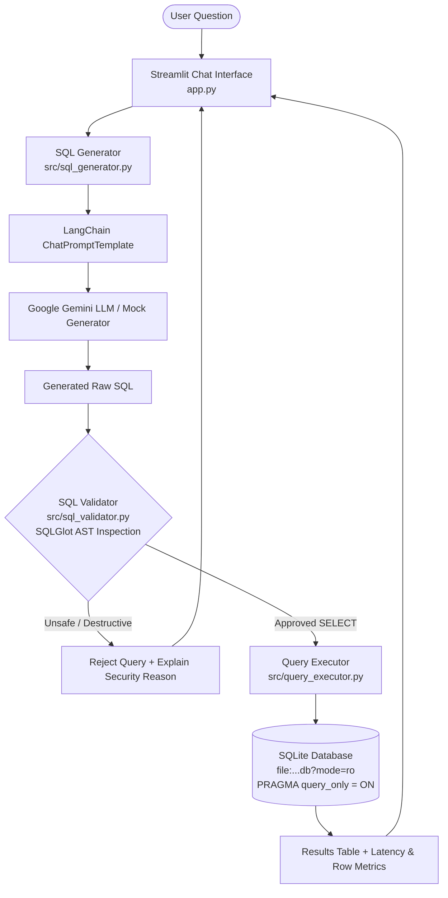

# Text-to-SQL Guarded Assistant (DAI-012)

[](https://www.python.org/)
[](https://docs.pytest.org/)
[](https://sqlglot.com/)
[](https://streamlit.io/)

A simple, functional, strictly read-only AI chat assistant that allows users to query a relational SQLite database using natural English. Built with **LangChain**, **Google Gemini**, **SQLGlot AST validation**, and **Streamlit**.

---

## 1. Problem Statement & Scope

Querying relational databases typically requires proficiency in SQL and deep knowledge of the schema. While Large Language Models (LLMs) can translate natural language into SQL, directly executing LLM-generated SQL against a database poses severe security and integrity hazards:
- **Destructive Operations**: Malicious prompts or model hallucinations could generate `DROP`, `DELETE`, `UPDATE`, or `ALTER` statements.
- **Query Chaining / Injection**: Attackers could append stacked statements via semicolons.
- **Unauthorized Data Access**: Queries could access system catalogs (e.g. `sqlite_master`) or confidential tables.
- **Resource Exhaustion**: Missing `LIMIT` clauses or expensive cartesian products could lock the database or exhaust memory.

### Solution: Defense-in-Depth
This application implements an independent validation and execution framework completely decoupled from the LLM:
1. **Natural Language to SQL**: LangChain and Google Gemini generate dialect-accurate SQLite SQL with clear business logic prompts.
2. **Independent AST Guardrails**: SQLGlot parses the AST, enforcing single-statement execution, blocking all non-SELECT operations, validating allowed tables/columns, and enforcing row limits.
3. **Sandboxed Read-Only Execution**: Approved queries execute strictly over read-only SQLite handles (`file:...db?mode=ro` and `PRAGMA query_only = ON`) with progress-handler execution timeouts.

---

## 2. Architecture Overview



Detailed component breakdowns and diagrams are available in [`docs/architecture.md`](file:///c:/Users/ashutosh%20verma/Desktop/TextToSql/docs/architecture.md).

---

## 3. Database Schema & Business Logic

The relational SQLite database comprises three tables defined in [`sql/schema.sql`](file:///c:/Users/ashutosh%20verma/Desktop/TextToSql/sql/schema.sql):
- **`customers`**: `customer_id` (PK), `name`, `city`, `signup_date`.
- **`products`**: `product_id` (PK), `product_name`, `category`, `unit_price` (`CHECK(unit_price > 0)`).
- **`orders`**: `order_id` (PK), `customer_id` (FK), `product_id` (FK), `quantity` (`CHECK(quantity > 0)`), `order_date`, `status` (`CHECK(status IN ('Completed', 'Pending', 'Cancelled', 'Shipped'))`).

### Business Rules
- **Total Sales / Revenue**: Calculated as `quantity * unit_price` (joining `orders` with `products`).
- **Exclusion of Cancelled Orders**: Calculations for sales and revenue automatically exclude `status = 'Cancelled'` unless explicitly requested.
- **Pending Orders**: Represent unfulfilled orders (`status = 'Pending'`).
- **Idempotency**: Repeated data ingestions use `INSERT OR IGNORE` and deduplication pipelines without duplicating records or corrupting foreign keys.

---

## 4. Installation & Setup (Windows)

### Prerequisites
- Python 3.10+ installed and added to `PATH`.

### Step 1: Clone or Navigate to Repository
```powershell
cd "c:\Users\ashutosh verma\Desktop\TextToSql"
```

### Step 2: Install Dependencies
```powershell
pip install -r requirements.txt
```

### Step 3: Configure Environment
Copy the `.env.example` file to `.env`:
```powershell
Copy-Item .env.example .env
```
Edit `.env` and set your `GEMINI_API_KEY`:
```env
GEMINI_API_KEY=your_actual_gemini_api_key_here
GEMINI_MODEL=gemini-1.5-flash
DATABASE_PATH=data/app_database.db
QUERY_TIMEOUT_SECONDS=5
MAX_ROW_LIMIT=1000
DEFAULT_ROW_LIMIT=100
```
> **Note**: If you don't have an API key, the application includes a deterministic **offline mock generator** that allows full testing and demonstration without an external API key.

### Step 4: Initialize and Ingest Database
Run the ingestion pipeline to generate realistic synthetic data and populate SQLite:
```powershell
python -m src.ingestion
```
Output:
```
[INFO] Generating synthetic dataset (seed=42)...
[INFO] Ingesting dataset into data\app_database.db...
[INFO] Ingestion completed. Processed 30 customers, 20 products, 120 orders.
```

---

## 5. Running the Assistant

Start the Streamlit chat application:
```powershell
streamlit run app.py
```
The application will open in your browser at `http://localhost:8501`.

### Key UI Features:
- **Chat Interface**: Ask questions naturally in the conversational prompt box.
- **SQL Inspection**: Expandable viewer with syntax-highlighted generated SQL.
- **Guardrail Status Badges**: Real-time visual feedback indicating whether the query passed or failed AST inspection.
- **Interactive Dataframe**: Tabular display with column sorting and search.
- **Performance Metrics**: Row count, execution latency (in milliseconds), and read-only status chips.
- **Sidebar**:
  - Live table row count counters.
  - Interactive table inspector and sample row viewer.
  - Quick-select screening question buttons.
  - Database re-seed button.

---

## 6. Security & Guardrails

The project employs **three layers of protection**:

| Guardrail | Mechanism | Implementation |
|---|---|---|
| **AST Parse Check** | Validates SQLite syntax and ensures single-statement execution | [`src/sql_validator.py`](file:///c:/Users/ashutosh%20verma/Desktop/TextToSql/src/sql_validator.py) |
| **Strict Read-Only Filter** | Rejects `DROP`, `DELETE`, `UPDATE`, `INSERT`, `ALTER`, `CREATE`, `PRAGMA` | [`src/sql_validator.py`](file:///c:/Users/ashutosh%20verma/Desktop/TextToSql/src/sql_validator.py) |
| **Catalog Allowlist** | Only permits access to `customers`, `products`, `orders`, and CTE aliases | [`src/sql_validator.py`](file:///c:/Users/ashutosh%20verma/Desktop/TextToSql/src/sql_validator.py) |
| **Catalog Blocklist** | Explicitly blocks SQLite system tables (`sqlite_master`, `sqlite_sequence`) | [`src/sql_validator.py`](file:///c:/Users/ashutosh%20verma/Desktop/TextToSql/src/sql_validator.py) |
| **Function Blocklist** | Blocks dangerous SQLite functions (`load_extension`, `eval`) | [`src/sql_validator.py`](file:///c:/Users/ashutosh%20verma/Desktop/TextToSql/src/sql_validator.py) |
| **Automatic LIMIT** | Injects `LIMIT 100` if omitted; clamps excessive limits to 1000 | [`src/sql_validator.py`](file:///c:/Users/ashutosh%20verma/Desktop/TextToSql/src/sql_validator.py) |
| **Driver Read-Only Handle** | Opens database via URI `mode=ro` and `PRAGMA query_only = ON` | [`src/query_executor.py`](file:///c:/Users/ashutosh%20verma/Desktop/TextToSql/src/query_executor.py) |
| **Execution Timeout** | Progress-handler callback interrupts queries running over 5 seconds | [`src/query_executor.py`](file:///c:/Users/ashutosh%20verma/Desktop/TextToSql/src/query_executor.py) |

For design rationale and tradeoffs, refer to [`docs/design_decisions.md`](file:///c:/Users/ashutosh%20verma/Desktop/TextToSql/docs/design_decisions.md).

---

## 7. Automated Testing Suite

The repository includes a comprehensive, isolated test suite that runs **completely offline without requiring an API key**.

Run the tests via pytest:
```powershell
pytest -v
```

### Test Coverage (21 Automated Tests):
- **SQL Validator Tests** ([`tests/test_sql_validator.py`](file:///c:/Users/ashutosh%20verma/Desktop/TextToSql/tests/test_sql_validator.py)):
  - Valid SELECT queries with joins, aggregations, CTEs, and filters.
  - Rejection of `DELETE`, `DROP TABLE`, `UPDATE`, `INSERT`.
  - Rejection of stacked multi-statements (`SELECT ...; DROP ...`).
  - Rejection of unauthorized tables and SQLite system catalog tables.
  - Rejection of dangerous functions (`load_extension`).
  - Automatic `LIMIT` clause injection and clamping.
- **Query Executor Tests** ([`tests/test_query_executor.py`](file:///c:/Users/ashutosh%20verma/Desktop/TextToSql/tests/test_query_executor.py)):
  - Read-only execution returning rows and execution metrics.
  - Database immutability (verifying database contents remain intact after write attempts).
  - Row capping and truncation flags.
  - Non-existent database handling.
- **Ingestion Pipeline Tests** ([`tests/test_ingestion.py`](file:///c:/Users/ashutosh%20verma/Desktop/TextToSql/tests/test_ingestion.py)):
  - Deduplication and idempotency over repeated ingestion cycles.
  - Filtering records with missing/invalid primary keys or missing names.
  - Filtering products with negative or zero unit prices.
  - Filtering orders with missing foreign keys or non-positive quantities.
- **SQL Generator Tests** ([`tests/test_sql_generator.py`](file:///c:/Users/ashutosh%20verma/Desktop/TextToSql/tests/test_sql_generator.py)):
  - Markdown fence sanitization and conversational prefix cleaning.
  - Offline mock generator producing valid, executable SQL.
  - Verification of all standard screening questions.

---

## 8. Example Screening Questions

You can test these natural language questions directly in the application:

1. *"How many orders are there?"*
   ```sql
   SELECT COUNT(*) AS total_orders FROM orders;
   ```
2. *"Which five products have the highest total sales?"*
   ```sql
   SELECT p.product_name, ROUND(SUM(o.quantity * p.unit_price), 2) AS total_sales
   FROM orders o JOIN products p ON o.product_id = p.product_id
   WHERE o.status != 'Cancelled'
   GROUP BY p.product_id, p.product_name
   ORDER BY total_sales DESC LIMIT 5;
   ```
3. *"Which customers have placed the most orders?"*
   ```sql
   SELECT c.name, COUNT(o.order_id) AS order_count
   FROM customers c JOIN orders o ON c.customer_id = o.customer_id
   GROUP BY c.customer_id, c.name
   ORDER BY order_count DESC LIMIT 5;
   ```
4. *"What is the total quantity ordered by product category?"*
   ```sql
   SELECT p.category, SUM(o.quantity) AS total_quantity
   FROM orders o JOIN products p ON o.product_id = p.product_id
   WHERE o.status != 'Cancelled'
   GROUP BY p.category
   ORDER BY total_quantity DESC;
   ```
5. *"Which cities have the most customers?"*
   ```sql
   SELECT city, COUNT(customer_id) AS customer_count
   FROM customers
   GROUP BY city
   ORDER BY customer_count DESC LIMIT 5;
   ```
6. *"How many orders are pending?"*
   ```sql
   SELECT COUNT(*) AS pending_orders
   FROM orders
   WHERE status = 'Pending';
   ```
7. *"Show the ten most recent orders with customer names."*
   ```sql
   SELECT o.order_id, c.name AS customer_name, o.order_date, o.status
   FROM orders o JOIN customers c ON o.customer_id = c.customer_id
   ORDER BY o.order_date DESC LIMIT 10;
   ```

---

## 9. Assumptions & Limitations

- **Dialect**: Specifically optimized for SQLite 3 syntax.
- **Scope**: Designed for read-only analytical queries; mutations (`INSERT`, `UPDATE`, `DELETE`) are intentionally rejected by design.
- **Row Limits**: Maximum allowable row limit is 1,000 records to maintain responsive interactive performance.
- **Complexity**: Highly complex queries with recursive queries or obscure SQLite extensions should be validated against the schema.

---

## 10. Documentation Index

- **[Project Plan](file:///c:/Users/ashutosh%20verma/Desktop/TextToSql/PLAN.md)**: Implementation scope, milestone breakdown, and completion criteria.
- **[Architecture Specification](file:///c:/Users/ashutosh%20verma/Desktop/TextToSql/docs/architecture.md)**: Data flow, component roles, and security boundaries.
- **[Design Decisions Log](file:///c:/Users/ashutosh%20verma/Desktop/TextToSql/docs/design_decisions.md)**: Tradeoffs between AST parsing vs regex, driver-level read-only handles, and progress handlers.
- **[Demo Video Script](file:///c:/Users/ashutosh%20verma/Desktop/TextToSql/docs/demo_script.md)**: Step-by-step 5-8 minute presentation outline.