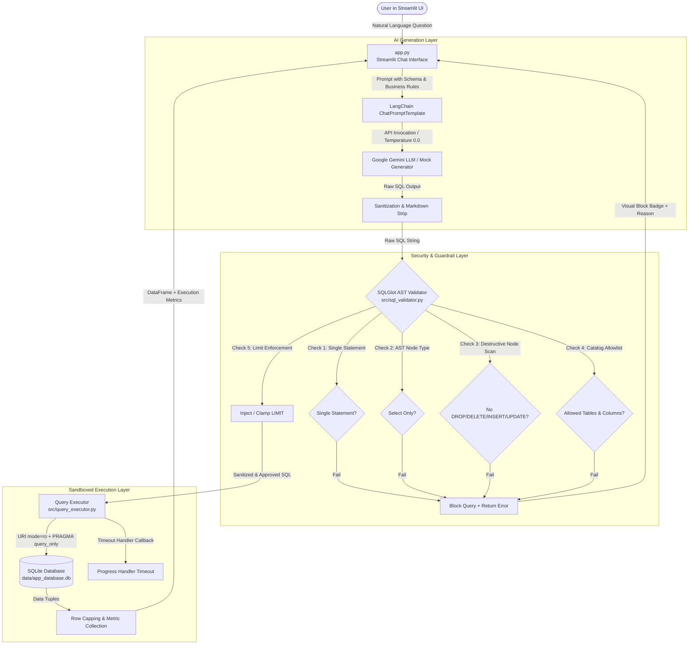

# Architecture Specification: Text-to-SQL Guarded Assistant

## 1. High-Level Architecture Overview

The **Text-to-SQL Guarded Assistant** is designed as a secure, read-only analytical assistant that converts natural language user questions into SQLite queries, validates them against strict AST security guardrails, and executes them in an isolated, read-only environment.

---

## 2. Component Breakdown

### 2.1 Configuration (`src/config.py`)
- Centralizes application settings loaded via `python-dotenv`.
- Controls runtime thresholds: `QUERY_TIMEOUT_SECONDS` (default 5s), `MAX_ROW_LIMIT` (default 1000), `DEFAULT_ROW_LIMIT` (default 100).
- Declares the strict table allowlist: `{'customers', 'products', 'orders'}`.
- Declares system blocklists (e.g., `sqlite_master`, `sqlite_sequence`) and forbidden functions (`load_extension`, `eval`).

### 2.2 Database Management (`src/database.py`)
- Provides DDL execution from `sql/schema.sql`.
- Provides two distinct connection handles:
  - `get_read_write_connection()`: Used only during ingestion.
  - `get_read_only_connection()`: Configured with `file:<path>?mode=ro` and `PRAGMA query_only = ON` to physically prevent writes at the SQLite driver layer.
- Performs schema introspection (`get_table_columns_map`, `get_schema_summary`, `get_sample_rows`).

### 2.3 Synthetic Data Generation & Ingestion (`src/data_generator.py` & `src/ingestion.py`)
- Generates reproducible, realistic relational datasets with seeded random seeds.
- Cleans and deduplicates records:
  - Filters out records with invalid/null primary keys or missing required fields.
  - Validates foreign keys (`orders.customer_id` -> `customers.customer_id`, `orders.product_id` -> `products.product_id`).
  - Idempotent insertion using `INSERT OR IGNORE`.

### 2.4 SQL Generation Layer (`src/sql_generator.py`)
- Interfaces with Google Gemini via `langchain-google-genai` and `langchain-core`.
- Injects strict prompt instructions:
  - SQLite 3 dialect rules.
  - Specific business logic (e.g. Sales = `quantity * unit_price`, status exclusion for cancelled orders).
  - Explicit rule to output only raw SQL without markdown fences.
- Sanitizes raw output with regex stripping for markdown quotes.
- Includes deterministic mock generator for offline mode and automated tests.

### 2.5 AST Guardrail Engine (`src/sql_validator.py`)
- Parses SQL text into an Abstract Syntax Tree (AST) using SQLGlot.
- Verifies single statement execution (rejecting semicolon stacking).
- Enforces root expression type: only `exp.Select` or `exp.Union` are permitted.
- Walks the AST to ensure no destructive operations exist (`exp.Insert`, `exp.Update`, `exp.Delete`, `exp.Drop`, `exp.Alter`, `exp.Create`, `exp.Pragma`, `exp.Command`).
- Checks all referenced `exp.Table` nodes against the allowed list (accounting for CTE aliases).
- Enforces row capping by checking or injecting `LIMIT` clauses.

### 2.6 Read-Only Query Executor (`src/query_executor.py`)
- Sandboxes execution on read-only SQLite connections.
- Sets a SQLite progress handler callback to abort queries exceeding the execution deadline.
- Caps result sets to prevent memory exhaustion.
- Records exact execution latency (ms) and row counts.

### 2.7 User Interface (`app.py`)
- Streamlit conversational chat interface.
- Expandable SQL inspection cards with syntax highlighting.
- Security badges indicating validation status and read-only protection.
- Dataframe visualization with row counts and query execution times.
- Interactive schema browser and quick-select screening questions in the sidebar.
